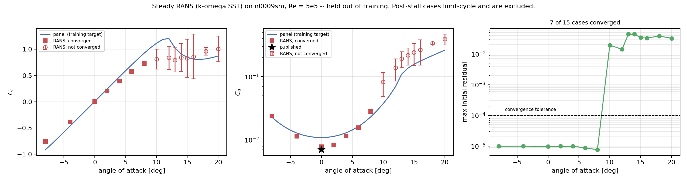
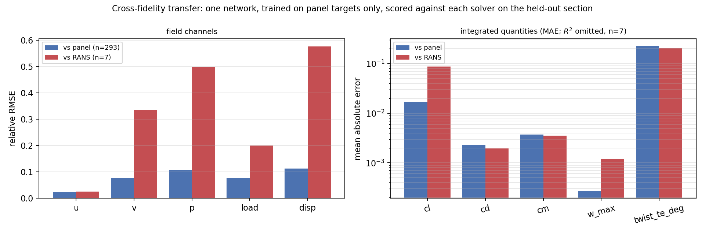

# Surrogate results

Everything here is reproduced from artefacts in this repository. Commands to
regenerate each number are at the bottom.

> **Sections 3 and 5 are from the previous network and are stale.** The
> surrogate was rewritten — 13-channel input with an inviscid physics prior,
> FiLM conditioning, wall-weighted scalar pooling, bilinear decoding,
> bottleneck attention, gradient + divergence + circulation losses, exact
> mirror augmentation and test-time averaging, EMA weights. The old checkpoint
> does not load into the new architecture and `SurrogatePredictor` refuses it
> by name rather than failing obscurely. Re-run the two commands in §8 to
> regenerate these tables; sections 1, 2, 4, 6 and 7 are unaffected because they
> describe the solvers and the dataset, not the network.

- Dataset: `artifacts/cfd/manifest.jsonl` — 1,928 cases
- Checkpoint: `artifacts/sensor/run/best.pt` — **stale**, 2.27 M parameters, epoch 58
- Scores: `artifacts/sensor/eval_test_panel.json`, `artifacts/sensor/eval_test_rans.json` — **stale**
- Figures: `poster/generated/fig_rans_validation.png`, `fig_fidelity_transfer.png`

---

## 1. Dataset

| | |
|---|---|
| Sections | 107 (NACA 4-digit, 5-digit, 6-series) |
| Angles | 18, from −8° to +20° |
| Panel cases | 1,913 |
| RANS cases | 15 (NACA 0009) |
| **Total** | **1,928** |
| Reynolds | 5 × 10⁵ |
| Grid | 128 × 128, ≈42 px/chord, 1.4 chords of wake |
| Splits | 76 train / 14 val / 17 test foils, **foil-disjoint** |

Splits hold out whole sections, never individual angles — splitting by case
would put the same shape in train and test at neighbouring incidences and
inflate the score without measuring generalisation. NACA 0009 is pinned to test.

Two backends write an identical `.npz` contract through one shared packer
(`sensor/cfd/adapt.py`), and every row carries a `fidelity` tag. Where a case
exists at both fidelities the merge keeps RANS.

Each case stores 5 field channels — `u`, `v`, `p` in the fluid, `load`, `disp`
in the solid — plus 5 scalars: `Cl`, `Cd`, `Cm`, `w_max`, `twist_TE`.

---

## 2. Panel backend vs published data

Hess–Smith panel method + Beddoes–Leishman static stall + momentum-consistent
wake. Reference: Abbott & von Doenhoff, Sheldahl & Klimas, Re = 5 × 10⁵.

| Quantity | Model | Reference |
|---|---|---|
| NACA 0012 `Cd_min` | 0.011 | 0.010 |
| NACA 0012 `Cl(8°)` | 0.96 | ~0.85 |
| NACA 0012 `Cl_max` | 1.36 @ 12° | 1.2–1.35 @ 13–14° |
| NACA 0012 `Cd(20°)` | 0.27 | ~0.30 |
| NACA 4412 `Cl(0°)` | 0.51 | ~0.45 |
| NACA 63-415 `α_L0` | −3.2° | −3.0° |
| Lift slope | within 3% | 2π(1 + 0.77 t/c) |
| Inviscid drag | < 10⁻² | 0 (d'Alembert) |
| Wake momentum ∫ | within 5% | `Cd`/2 |

Systematically 5–15% high near stall, ~10% low on deep-stall drag. Correlation
error, not solver error — and systematic, which is what matters for a target.

---

## 3. U-Net, held-out sections  *(stale — previous architecture)*

306 cases across 17 unseen shapes, scored against the panel targets it was
trained on. 64 × 64 configuration, 60 epochs.

| Scalar | R² | MAE |
|---|---|---|
| `Cl` | 0.996 | 0.033 |
| `Cd` | 0.996 | 0.0029 |
| `Cm` | 0.985 | 0.0056 |
| `w_max / c` | 0.900 | 4.3 × 10⁻⁴ |
| `twist_TE` | 0.739 | 0.37° |

| Field | relative RMSE |
|---|---|
| `u` | 0.025 |
| `v` | 0.158 |
| `p` | 0.166 |
| `load` | 0.040 |
| `disp` | 0.239 |

Inference is milliseconds against ~4 minutes for the corresponding RANS solve.

---

## 4. RANS validation, NACA 0009

15 cases, k-ω SST, `simpleFoam`, 324 k prisms, 2-D. Section held out of
training entirely.

**7 of 15 converged.** Every case at α ≥ 10° hit the 2,000-iteration cap with
initial residuals of order 10⁻². Steady SIMPLE does not reach a fixed point on
massively separated flow — it limit-cycles, and lift oscillates by up to ±0.43.
Convergence is recorded per case and the rest are excluded.

| α [deg] | `Cl` | `Cd` | `Cd_std` | converged | residual |
|---|---|---|---|---|---|
| −8 | −0.761 | 0.0238 | 0.0001 | yes | 1.0 × 10⁻⁵ |
| −4 | −0.386 | 0.0114 | 0.0009 | yes | 1.0 × 10⁻⁵ |
| 0 | 0.001 | 0.0078 | 0.0000 | yes | 9.8 × 10⁻⁶ |
| 2 | 0.204 | 0.0083 | 0.0000 | yes | 9.9 × 10⁻⁶ |
| 4 | 0.395 | 0.0115 | 0.0013 | yes | 1.0 × 10⁻⁵ |
| 6 | 0.581 | 0.0155 | 0.0016 | yes | 8.8 × 10⁻⁶ |
| 8 | 0.729 | 0.0281 | 0.0001 | yes | 7.7 × 10⁻⁶ |
| 10–20 | — | — | 0.19–0.43 | **no** | 1.4–4.4 × 10⁻² |

Converged branch against published NACA 0009:

| | RANS | reference |
|---|---|---|
| Lift slope | 0.099 /deg = 5.67 /rad = 90% of 2π | thin-airfoil theory |
| `Cd_min` | 0.0078 at α = 0 | 0.006–0.008 |
| Drag minimum location | α = 0 | α = 0, symmetric |
| ±4° lift symmetry | 2.3% | 0 |

**Claim RANS validation for α ≤ 8° only.**



---

## 5. Cross-fidelity transfer  *(stale — previous architecture, panel-only training)*

One network, trained on panel targets only, scored against each solver on the
held-out section. A mixed score is neither quantity, so they are reported apart.

| | vs panel (n = 293) | vs RANS (n = 7) |
|---|---|---|
| `u` rel-RMSE | 0.025 | **0.020** |
| `v` rel-RMSE | 0.158 | 0.235 |
| `p` rel-RMSE | 0.166 | 0.357 |
| `load` rel-RMSE | 0.040 | 0.126 |
| `disp` rel-RMSE | 0.239 | 0.521 |
| `Cl` MAE | 0.033 | 0.078 |
| `Cd` MAE | 0.0029 | 0.0029 |



Three findings:

1. **Velocity field and drag transfer.** `u` error is *lower* against RANS than
   against the panel targets, and `Cd` MAE is identical. The network learned
   flow structure rather than solver artefacts.
2. **Lift carries the panel model's bias** — 2.3× the error. The panel backend
   runs high near stall by design; the surrogate inherited it.
3. **Structural channels do not transfer** (`disp` 0.52). The chordwise beam
   amplifies leading-edge pressure differences, which is exactly where the panel
   method and RANS disagree most. Load and displacement at RANS fidelity need
   RANS cases in *training*, not only in test.

**Do not quote R² for `Cm`, `w_max` or `twist` on the RANS rows.** With n = 7 on
a symmetric section those have near-zero variance, so `R² = 1 − SS_res/SS_tot`
is dominated by a vanishing denominator and returns large negative numbers that
describe the sample, not the model. Report MAE and state n.

---

## 6. Defects found and fixed

Each of these produced plausible-looking output before it was caught.

| Defect | Symptom | Cause |
|---|---|---|
| Blunt trailing edge | symmetric section reported `α_L0` = −2.6° | Kutta condition imposed on base panels, not surface panels |
| Panel clustering | `Cp_max` = 0.64 instead of 1.0 | cosine spacing bunched only at the TE, leaving the stagnation point unresolved |
| Wake spreading | wake 0.17 c wide behind an attached foil | `b² ∝ 1.44 θx`; self-similar turbulent plane wake is ≈0.25 |
| Beam ridge term | cantilever twice as stiff as closed form | ridge on the assembled matrix acted as a Winkler foundation with λ ≈ chord |
| Suction-side selector | rectangular step in the rendered fields | surfaces split by sign of `y` instead of by the chord line |
| Constant input channel | `predict()` returned a constant while cached eval read R² = 0.99 | `std + 1e-6` on a zero-variance Reynolds channel amplified float16 rounding 10⁶× |
| BLAS thread oversubscription | pool 11× slower than a serial loop | 4 workers × 4 BLAS threads on 4 cores |
| Relative mesh path | `gmshToFoam` aborted on `UPtrList<polyPatch>::last()` | every command runs `cd <case> && …`; a repo-relative `.msh` path resolved to nothing, and gmshToFoam treats a missing file as zero patches |
| Manifest merge glob | 15 solved RANS cases silently discarded | glob was `chunk_*.jsonl`; the RANS driver writes `rans_*.jsonl` |
| Merge tie-break | RANS rows lost to panel rows | ranked on field completeness; a RANS row legitimately lacks the panel viscous scalars |
| Cache invalidation | re-solved cases kept serving old arrays | `done` flags are positional and were never compared against file mtimes |
| Force-coefficient window | `Cd(0°)` > `Cd(2°)` on a symmetric section | fixed 500-iteration average reached into the start-up transient on runs that converged early |
| Convergence flag | post-stall lift non-monotonic: 0.35 → 1.03 → 0.65 | `converged` read the process return code; `simpleFoam` exits 0 regardless of residuals |

Test suite: **220 tests**. Physics tests check against results that predate this
repository — thin-airfoil theory, d'Alembert's paradox, the stagnation
condition, closed-form cantilever deflection, the cantilever eigenvalue, and the
momentum-integral theorem.

---

## 7. Not done

- **No PIV.** The rig is not connected. `Data/schema.py` defines the contract and
  `sensor/bridge.py` fills it from the surrogate; every record self-labels
  `provenance.signals = "synthesised by a 1-DOF instrument model, not measured"`.
- **No high-fidelity rows in training yet.** The mechanism is now three-part —
  a fidelity *conditioning channel*, per-fidelity loss weights, and two-stage
  fine-tuning — and `sensor-multifidelity` picks train-split foils and solves
  them. But it has not been *run*: the only RANS cases in the dataset are still
  the 15 on NACA 0009, which is in the test split. Until it is run, asking a
  checkpoint for `fidelity="rans"` returns an extrapolation warning, by design.
  The run itself is scripted end to end (`scripts/run_multifidelity.sh`) and
  gated (`scripts/verify_multifidelity.py data`), which is what turns "the code
  supports it" into a number that can be reported. The gate currently fails, on
  exactly these two counts, and printing that failure is the point of it.
- **Structural coupling is one-way and static.** Pressure drives deflection;
  deflection does not feed back.
- **URANS is written but not run.** `sensor/cfd/unsteady.py` and its analysis
  are tested end-to-end on synthetic records and on the OpenFOAM output format
  (`tests/test_unsteady.py`, 10 tests), but no transient case has been solved
  yet. Every post-stall number in this document is still from the steady solver
  and is still unusable. The plan is 12 cases — `n64012a`, `naca0008`,
  `naca23018`, `naca63206` at 12°, 16°, 20° — at hours apiece, which is the
  entire schedule risk in this project.
- **Fixed on the way there, worth stating because both were silent.** The sweep
  drivers wrote their rows only after the final case returned, so an
  interruption anywhere in a day-long URANS sweep threw away every solved case;
  rows are now flushed per case and an already-solved case is skipped on
  re-run. And the twin bridge's preference for a measured shedding frequency
  could never fire, because nothing attached the URANS block to a live case —
  `digital_twin` now looks it up in the manifest, and
  `provenance.shedding_frequency` says which frequency the record was built on.

---

## 8. Reproducing

The network was rewritten; §3 and §5 need regenerating from scratch. The cache
must be rebuilt first — the input tensor went from 4 channels to 13, and
`sensor-cache` detects the mismatch and rebuilds rather than serving arrays of
the wrong width.

```bash
python cli.py sensor-generate
python cli.py sensor-cache                                   # ~13 min, 13 channels
python cli.py sensor-train --epochs 80 --batch-size 16       # full 128x128
python cli.py sensor-eval --split test --fidelity panel --out-path artifacts/sensor/eval_test_panel.json
python cli.py sensor-eval --split test --fidelity panel --tta=False   # TTA ablation
python -m sensor.figures --out poster/generated
python -m pytest tests/ -q
```

Two ablations worth reporting alongside the headline numbers, because each
isolates one of the changes:

```bash
python cli.py sensor-cache --spec v2_noprior --out-dir artifacts/sensor/cache_np
python cli.py sensor-train --cache-dir artifacts/sensor/cache_np --run-dir artifacts/sensor/run_np
python cli.py sensor-train --run-dir artifacts/sensor/run_noaug --augment=False
```

RANS set (needs OpenFOAM v2606 + gmsh; ≈3 h on an M4 Pro, most of it the eight
post-stall cases that never converge):

```bash
python cli.py sensor-rans --foils Data/Airfoils/4/n0009sm.dat.txt --alphas="-8,-4,0,2,4,6,8" --max-workers 4
python cli.py sensor-finalize
python cli.py sensor-cache
python cli.py sensor-eval --split test --fidelity rans --converged-only --out-path artifacts/sensor/eval_test_rans.json
```

High-fidelity rows on *training* foils, plus URANS past stall — this is the run
that makes multi-fidelity training legitimate. It is a day or more of compute,
so drive it with the script rather than by hand: every stage is marked, logged
and resumable, and the two gates run in the right places.

```bash
./scripts/run_multifidelity.sh --dry-run              # what it will do
nohup ./scripts/run_multifidelity.sh > artifacts/mf_logs/driver.log 2>&1 &
./scripts/run_multifidelity.sh --list                 # progress
```

The same thing by hand, if a stage needs to be redone in isolation:

```bash
python cli.py sensor-multifidelity                     # print the plan first
python cli.py sensor-multifidelity --run --max-workers 4
python cli.py sensor-finalize
python scripts/verify_multifidelity.py data            # training on test? gate
python cli.py sensor-cache
python cli.py sensor-train --lr 2e-4 --init-from artifacts/sensor/run3/best.pt \
    --run-dir artifacts/sensor/run_mf --fidelity-weights "panel=1,rans=8,urans=8"
python cli.py sensor-eval --checkpoint artifacts/sensor/run_mf/best.pt \
    --split test --fidelity rans --converged-only \
    --out-path artifacts/sensor/eval_test_rans_mf.json
python scripts/verify_multifidelity.py model           # did it actually improve
```

Interactive zsh does not treat `#` as a comment, so a trailing note on these
commands arrives as positional arguments. `cli.py` detects and rejects that
rather than binding it to a parameter. Note also the `--alphas="-8,..."` form
above: a bare leading minus is parsed as a flag.
