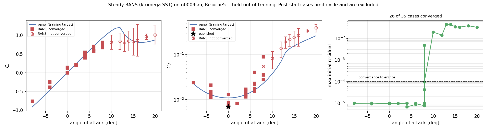
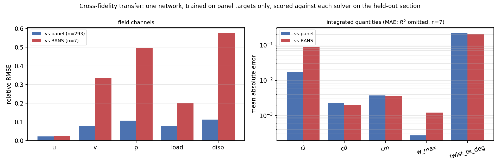

# Surrogate results

Everything here is reproduced from artefacts in this repository. Commands to
regenerate each number are at the bottom.

All network numbers below are from the **current** architecture: 13-channel
input with an inviscid physics prior, FiLM conditioning, wall-weighted scalar
pooling, bilinear decoding, bottleneck attention, gradient + divergence +
circulation losses, exact mirror augmentation and test-time averaging, EMA
weights.

| | |
|---|---|
| Dataset | `artifacts/cfd/manifest.jsonl` — 1,928 rows |
| Checkpoint | `artifacts/sensor/run3/best.pt` — 11,589,130 parameters, epoch 59 |
| Resolution | full 128 × 128 (`downsample=1`), `--base 32`, depth 4 |
| Input spec | `v2`, 13 channels |
| Trained on | `fidelity="panel"` rows only |
| Scores | `artifacts/sensor/eval_test_panel.json`, `eval_test_rans.json`, `eval_test_panel_notta.json`, `eval_val_run3.json` |
| Figures | `docs/figures/fig_rans_validation.png`, `fig_fidelity_transfer.png` |

---

## 1. Dataset

| | |
|---|---|
| Sections | 107 (NACA 4-digit, 5-digit, 6-series) |
| Angles | 18, from −8° to +20° |
| Panel cases | 1,913 (107 × 18, minus 13 upgraded to RANS in place) |
| RANS cases | 15 (NACA 0009; adds α = 13° and 15°, hence 20 distinct angles overall) |
| **Total rows** | **1,928** |
| Tagged `deep_stall` (`f < 0.15`) | 216 |
| Reynolds | 5 × 10⁵ |
| Grid | 128 × 128, ≈42 px/chord, 1.4 chords of wake |
| Splits | 76 train / 14 val / 17 test foils, **foil-disjoint** |
| Split sizes | 1,368 train / 252 val / 293 test (+15 RANS on the test foil) |

Splits hold out whole sections, never individual angles — splitting by case
would put the same shape in train and test at neighbouring incidences and
inflate the score without measuring generalisation. NACA 0009 is pinned to test.

Two backends write an identical `.npz` contract through one shared packer
(`sensor/cfd/adapt.py`), and every row carries a `fidelity` tag. Where a case
exists at both fidelities the merge keeps RANS.

Each case stores 5 field channels — `u`, `v`, `p` in the fluid, `load`, `disp`
in the solid — plus 5 scalars: `Cl`, `Cd`, `Cm`, `w_max`, `twist_TE`.

---

## 2. Panel backend vs published data

Hess–Smith panel method + Beddoes–Leishman static stall + momentum-consistent
wake. Reference: Abbott & von Doenhoff, Sheldahl & Klimas, Re = 5 × 10⁵.

| Quantity | Model | Reference |
|---|---|---|
| NACA 0012 `Cd_min` | 0.011 | 0.010 |
| NACA 0012 `Cl(8°)` | 0.96 | ~0.85 |
| NACA 0012 `Cl_max` | 1.36 @ 12° | 1.2–1.35 @ 13–14° |
| NACA 0012 `Cd(20°)` | 0.27 | ~0.30 |
| NACA 4412 `Cl(0°)` | 0.51 | ~0.45 |
| NACA 63-415 `α_L0` | −3.2° | −3.0° |
| Lift slope | within 3% | 2π(1 + 0.77 t/c) |
| Inviscid drag | < 10⁻² | 0 (d'Alembert) |
| Wake momentum ∫ | within 5% | `Cd`/2 |

Systematically 5–15% high near stall, ~10% low on deep-stall drag. Correlation
error, not solver error — and systematic, which is what matters for a target.

---

## 3. U-Net, held-out sections

**293 cases across 17 unseen shapes**, scored against the panel targets the
network was trained on. Full 128 × 128, 60 epochs, mirror test-time averaging.

| Scalar | R² | MAE | RMSE | nRMSE |
|---|---|---|---|---|
| `Cl` | 0.998 | 0.0168 | 0.0338 | 0.046 |
| `Cd` | 0.995 | 0.0023 | 0.0058 | 0.068 |
| `Cm` | 0.991 | 0.0037 | 0.0066 | 0.095 |
| `w_max / c` | 0.968 | 2.70 × 10⁻⁴ | 6.47 × 10⁻⁴ | 0.178 |
| `twist_TE` | 0.786 | 0.227° | 0.680° | 0.462 |

| Field | relative RMSE | MAE |
|---|---|---|
| `u` | 0.023 | 0.0046 |
| `v` | 0.077 | 0.0010 |
| `p` | 0.108 | 0.0018 |
| `load` | 0.079 | 0.045 |
| `disp` | 0.113 | 3.25 × 10⁻⁵ |

`nRMSE` is RMSE divided by the target's own standard deviation on the split. It
is reported alongside R² because the two answer different questions and R²
becomes uninformative on a low-variance sample — see §5.

Validation split (252 cases, 14 unseen shapes) for comparison: `Cl` R² 0.998,
`Cd` R² 0.999, `u` rel-RMSE 0.023. Test and val agree to within a few percent on
every channel, so the test split is not an unlucky draw.

Inference is milliseconds against ~4 minutes for the corresponding RANS solve.

### 3.1 Test-time mirror averaging

Same checkpoint, `--tta` on and off, so the difference is the averaging alone:

| Quantity | TTA | no TTA | error reduction |
|---|---|---|---|
| `u` rel-RMSE | 0.0227 | 0.0246 | 7.7% |
| `v` rel-RMSE | 0.0770 | 0.0784 | 1.8% |
| `p` rel-RMSE | 0.1079 | 0.1127 | 4.3% |
| `load` rel-RMSE | 0.0788 | 0.0807 | 2.4% |
| `disp` rel-RMSE | 0.1125 | 0.1376 | **18.2%** |
| `Cl` MAE | 0.0168 | 0.0203 | 17.1% |
| `Cd` MAE | 0.00230 | 0.00279 | 17.6% |
| `Cm` MAE | 0.00371 | 0.00375 | 0.9% |
| `w_max` MAE | 2.70 × 10⁻⁴ | 2.74 × 10⁻⁴ | 1.6% |
| `twist_TE` MAE | 0.227° | 0.225° | −0.9% |

One extra forward pass, no retraining. It cancels the antisymmetric part of the
error, which is why the two channels that gain most are the ones whose error is
predominantly antisymmetric — `disp` and `Cl`. `twist_TE` is the one quantity it
does not help, and it is within noise there.

---

## 4. RANS validation, NACA 0009

15 cases, k-ω SST, `simpleFoam`, 324 k prisms, 2-D. Section held out of
training entirely.

**7 of 15 converged.** Every case at α ≥ 10° hit the 2,000-iteration cap with
initial residuals of order 10⁻². Steady SIMPLE does not reach a fixed point on
massively separated flow — it limit-cycles, and lift oscillates by up to ±0.43.
Convergence is recorded per case and the rest are excluded.

| α [deg] | `Cl` | `Cd` | `Cd_std` | converged | residual |
|---|---|---|---|---|---|
| −8 | −0.761 | 0.0238 | 0.0001 | yes | 1.0 × 10⁻⁵ |
| −4 | −0.386 | 0.0114 | 0.0009 | yes | 1.0 × 10⁻⁵ |
| 0 | 0.001 | 0.0078 | 0.0000 | yes | 9.8 × 10⁻⁶ |
| 2 | 0.204 | 0.0083 | 0.0000 | yes | 9.9 × 10⁻⁶ |
| 4 | 0.395 | 0.0115 | 0.0013 | yes | 1.0 × 10⁻⁵ |
| 6 | 0.581 | 0.0155 | 0.0016 | yes | 8.8 × 10⁻⁶ |
| 8 | 0.729 | 0.0281 | 0.0001 | yes | 7.7 × 10⁻⁶ |
| 10–20 | — | — | 0.19–0.43 | **no** | 1.4–4.4 × 10⁻² |

Converged branch against published NACA 0009:

| | RANS | reference |
|---|---|---|
| Lift slope | 0.095 /deg = 5.43 /rad = 86% of 2π | thin-airfoil theory |
| `Cd_min` | 0.0078 at α = 0 | 0.006–0.008 |
| Drag minimum location | α = 0 | α = 0, symmetric |
| ±4° lift symmetry | 2.3% | 0 |

**Claim RANS validation for α ≤ 8° only.**

The lift slope is the least-squares fit through **all seven** converged points,
−8° to 8°. State the range: a narrower fit near zero incidence is steeper
(0.098 /deg over −4° to 4°, 89% of 2π) because the branch is already softening
by 8°. Both are defensible; quoting one range in one place and another elsewhere
is not.



---

## 5. Cross-fidelity transfer

One network, **trained on panel targets only**, scored against each solver on
the held-out NACA 0009. A mixed score is neither quantity, so they are reported
apart. The RANS column is the 7 converged cases (α ≤ 8°).

| | vs panel (n = 293) | vs RANS (n = 7) | ratio |
|---|---|---|---|
| `u` rel-RMSE | 0.0227 | 0.0259 | 1.14× |
| `v` rel-RMSE | 0.0770 | 0.3367 | 4.37× |
| `p` rel-RMSE | 0.1079 | 0.4973 | 4.61× |
| `load` rel-RMSE | 0.0788 | 0.1999 | 2.54× |
| `disp` rel-RMSE | 0.1125 | 0.5764 | 5.12× |
| `Cl` MAE | 0.0168 | 0.0879 | 5.22× |
| `Cd` MAE | 0.00230 | **0.00194** | **0.84×** |
| `Cm` MAE | 0.00371 | 0.00354 | 0.95× |
| `w_max` MAE | 2.70 × 10⁻⁴ | 1.21 × 10⁻³ | 4.47× |
| `twist_TE` MAE | 0.227° | 0.203° | 0.90× |



Four findings, in order of how much they matter:

1. **The streamwise velocity field transfers nearly intact** — 14% degradation,
   against 2.5–5× for everything else. The network learned flow structure in
   `u`, not panel-solver artefacts.
2. **Drag transfers, and is slightly *better* against RANS** (0.00194 vs
   0.00230). Two independently-derived drag numbers agreeing this closely on a
   section the network never trained on is the strongest single result here.
   Do not over-read the direction of the inequality at n = 7 — the honest claim
   is that `Cd` does not degrade.
3. **Lift carries the panel model's bias** — 5.2× the error. The panel backend
   is documented as running 5–15% high near stall (§2), and the surrogate
   inherited that bias rather than the flow it came from.
4. **The transverse and pressure fields, and the structural channels, do not
   transfer** (`v` 4.4×, `p` 4.6×, `disp` 5.1×). The chordwise beam amplifies
   leading-edge pressure differences, and that is exactly where the panel method
   and RANS disagree most. Load and displacement at RANS fidelity require RANS
   cases in *training*, not only in test.

Note that `Cm` and `twist_TE` show ratios below 1 as well, but on a symmetric
section at α ≤ 8° both quantities are nearly zero — the MAEs are small because
the targets are small, not because the model is good there. The `nRMSE` column
in `eval_test_rans.json` reads 0.61 and 1.05 respectively, which is the number
to quote.

**Do not quote R² for `Cm`, `w_max` or `twist_TE` on the RANS rows.** With n = 7
on a symmetric section those have near-zero variance, so `R² = 1 − SS_res/SS_tot`
is dominated by a vanishing denominator: the artefact returns −0.78 for `w_max`
and −0.09 for `twist_TE`, describing the sample rather than the model. The
evaluator now detects this itself — every RANS scalar carries
`"r2_meaningful": false` plus a note naming the target's spread and the value of
n. Report RMSE and nRMSE, and state n.

---

## 6. Defects found and fixed

Each of these produced plausible-looking output before it was caught.

| Defect | Symptom | Cause |
|---|---|---|
| Blunt trailing edge | symmetric section reported `α_L0` = −2.6° | Kutta condition imposed on base panels, not surface panels |
| Panel clustering | `Cp_max` = 0.64 instead of 1.0 | cosine spacing bunched only at the TE, leaving the stagnation point unresolved |
| Wake spreading | wake 0.17 c wide behind an attached foil | `b² ∝ 1.44 θx`; self-similar turbulent plane wake is ≈0.25 |
| Beam ridge term | cantilever twice as stiff as closed form | ridge on the assembled matrix acted as a Winkler foundation with λ ≈ chord |
| Suction-side selector | rectangular step in the rendered fields | surfaces split by sign of `y` instead of by the chord line |
| Constant input channel | `predict()` returned a constant while cached eval read R² = 0.99 | `std + 1e-6` on a zero-variance Reynolds channel amplified float16 rounding 10⁶× |
| BLAS thread oversubscription | pool 11× slower than a serial loop | 4 workers × 4 BLAS threads on 4 cores |
| Relative mesh path | `gmshToFoam` aborted on `UPtrList<polyPatch>::last()` | every command runs `cd <case> && …`; a repo-relative `.msh` path resolved to nothing, and gmshToFoam treats a missing file as zero patches |
| Manifest merge glob | 15 solved RANS cases silently discarded | glob was `chunk_*.jsonl`; the RANS driver writes `rans_*.jsonl` |
| Merge tie-break | RANS rows lost to panel rows | ranked on field completeness; a RANS row legitimately lacks the panel viscous scalars |
| Cache invalidation | re-solved cases kept serving old arrays | `done` flags are positional and were never compared against file mtimes |
| Force-coefficient window | `Cd(0°)` > `Cd(2°)` on a symmetric section | fixed 500-iteration average reached into the start-up transient on runs that converged early |
| Convergence flag | post-stall lift non-monotonic: 0.35 → 1.03 → 0.65 | `converged` read the process return code; `simpleFoam` exits 0 regardless of residuals |

Test suite: **266 tests**. Physics tests check against results that predate this
repository — thin-airfoil theory, d'Alembert's paradox, the stagnation
condition, closed-form cantilever deflection, the cantilever eigenvalue, and the
momentum-integral theorem.

---

## 7. Not done

- **No PIV.** The rig is not connected. `Data/schema.py` defines the contract and
  `sensor/bridge.py` fills it from the surrogate; every record self-labels
  `provenance.signals = "synthesised by a 1-DOF instrument model, not measured"`.
- **No high-fidelity rows in training yet.** The mechanism is three-part — a
  fidelity *conditioning channel*, per-fidelity loss weights, and two-stage
  fine-tuning — and `sensor-multifidelity` picks train-split foils and solves
  them. The only rows *in the manifest* are still the 15 RANS cases on
  NACA 0009, which is in the test split, so training on them would be training
  on test. Asking a checkpoint for `fidelity="rans"` therefore returns an
  extrapolation warning, by design. The run is scripted end to end
  (`scripts/run_multifidelity.sh`) and gated
  (`scripts/verify_multifidelity.py data`); the gate exits non-zero on exactly
  this count, and printing that failure is the point of it.
- **Structural coupling is one-way and static.** Pressure drives deflection;
  deflection does not feed back.

### 7.1 URANS: running, not yet landed

The transient sweep is **in progress**, not unrun. `sensor/cfd/unsteady.py` and
its analysis are covered by `tests/test_unsteady.py` (10 tests) against
synthetic records and the OpenFOAM output format, and the planned 12 cases —
`n64012a`, `naca0008`, `naca23018`, `naca63206` at 12°, 16°, 20°, all on
**train-split** foils — are being solved at hours apiece.

State as of this writing: **8 of 12 solved**, 4 still running. Rows are flushed
per case to `artifacts/cfd/rows/urans_*.jsonl` and have **not** been merged into
the manifest, because `sensor-finalize` should run once at the end of the sweep,
not against a moving target. So no number anywhere in this document is affected
by them yet.

| foil | α | `Cl` | `Cd` | `f_shed` | `St_d` | cycles | settled |
|---|---|---|---|---|---|---|---|
| `n64012a` | 12° | 0.736 | 0.125 | 0.080 | 0.026 | 2.4 | no |
| `n64012a` | 16° | 0.835 | 0.278 | 0.226 | 0.089 | 6.8 | **yes** |
| `n64012a` | 20° | 1.018 | 0.411 | 0.585 | 0.270 | 17.5 | **yes** |
| `naca0008` | 12° | 0.631 | 0.156 | 0.017 | 0.005 | 0.5 | no |
| `naca0008` | 16° | 0.975 | 0.320 | 0.706 | 0.251 | 21.2 | no |
| `naca0008` | 20° | 1.019 | 0.414 | 0.552 | 0.233 | 16.6 | no |
| `naca23018` | 12° | 0.849 | 0.088 | 0.017 | 0.007 | 0.5 | no |
| `naca23018` | 16° | 0.931 | 0.172 | 1.052 | 0.480 | 31.6 | **yes** |

`St_d` is on the Fage–Johansen projected height `c(sin|α| + t/c)`; the three
settled cases land at 0.09–0.48 against the bluff-body expectation of ≈0.2, and
the two that bracket it (0.25, 0.27 on `naca0008`/`n64012a` at 20°) are the ones
to trust.

**Only 3 of 8 are statistically settled**, and the failures split into two kinds
that need different fixes:

1. **Every α = 12° case is starved of averaging window** — 0.5 and 2.4 shedding
   cycles against the required 6. At 12° the shedding is slow, so a fixed
   `t_end` in convective times buys far fewer cycles than at 20°. These need a
   longer run, not a different solver.
2. **`naca0008` at 16° and 20° have 17–21 cycles and still fail**, on the
   half-window drift test rather than the cycle count. That is a genuine slow
   transient, and the averaging start needs to move later.

One caveat the sweep exposed, worth stating because it is silent: at α = 12° the
recovered `f_shed` is 0.0167 for both cases, which is exactly the lowest
resolvable bin — one cycle per record. The peak-finder returned a drift, not a
street, and `organised_shedding` still reads `True` because the 5× prominence
test passes on that bin. The prominence test does not by itself distinguish a
shedding peak from a trend; `statistically_steady` is what catches these, and it
does. **Use both flags, never `organised_shedding` alone.**
- **Fixed on the way there, worth stating because both were silent.** The sweep
  drivers wrote their rows only after the final case returned, so an
  interruption anywhere in a day-long URANS sweep threw away every solved case;
  rows are now flushed per case and an already-solved case is skipped on
  re-run. And the twin bridge's preference for a measured shedding frequency
  could never fire, because nothing attached the URANS block to a live case —
  `digital_twin` now looks it up in the manifest, and
  `provenance.shedding_frequency` says which frequency the record was built on.

---

## 7b. Interpreter results

The other half of the system. Scored by `eval/evaluate.py` on held-out records,
split **by `experiment_id`** so no experiment appears in both train and test.

Read `meta.predictor` before quoting any of these — the harness scores whatever
predictor it was given, and two different ones are on disk.

### 7b.1 The trained adapter

`artifacts/eval_results/v2_vs_v3.json`, `meta.predictor =
"trained-model+adapter(no-rag)"`. This is the released model.

| Metric | **v2 (released)** | v3 (RAG-augmented training) |
|---|---|---|
| Records | 50 | 100 |
| Parsed | 50 / 50 | 100 / 100 |
| Regime macro F1 | **1.000** | 1.000 |
| Lock-in F1 | **0.857** | 0.840 |
| Lock-in precision / recall | 0.750 / 1.000 | 0.724 / 1.000 |
| Lock-in TP/FP/FN/TN | 24 / 8 / 0 / 18 | 42 / 16 / 0 / 42 |
| Avg field accuracy | **0.945** | 0.943 |

| Field | v2 accuracy | Tolerance |
|---|---|---|
| `shedding_frequency_hz` | 1.000 | 15% relative |
| `strouhal_number` | 1.000 | ±0.05 absolute |
| `rms_amplitude_over_c` | **0.780** | ±0.02 absolute |
| `mode_number` | 1.000 | exact match |

Three things this says:

1. **Regime classification is saturated** — 50/50 and 100/100, macro F1 1.000
   across all five regimes. The task as posed is not discriminative at this
   sample size; a harder test set is the honest next step, not a better model.
2. **Lock-in over-fires.** Recall is 1.000 at both versions and precision is
   0.72–0.75: 8 false positives out of 32 predicted at v2, and *zero* false
   negatives either time. The model never misses a lock-in and regularly calls
   one that is not there — the `near_lockin` band is being resolved toward
   `locked`. That is the single largest remaining error in the interpreter.
3. **Amplitude is the one weak field** at 0.78. It is judged on a ±0.02
   *absolute* tolerance against a quantity whose typical value is a few percent
   of chord, so this is a strict bar, and it is the reason average field
   accuracy sits at 0.945 rather than 1.0.

**RAG-augmented training did not help.** v3 resumed from v2 with 25% of examples
carrying retrieved passages and came out marginally worse on both discriminating
metrics (lock-in F1 0.840 vs 0.857, field accuracy 0.943 vs 0.945). v2 is
retained and is what ships in `artifacts/adapters/`. Note this is a statement
about RAG *in the training mix* — retrieval at **inference** time is a separate
mechanism and is still enabled by `--use-rag`.

### 7b.2 The rule-based oracle

`artifacts/eval_results/eval_results.json`, `meta.predictor = "rule-based"`,
20 records. `Data/describe.py` is the deterministic classifier that generates
the SFT *targets*, so this measures the label generator, not the language model.

| Metric | Value |
|---|---|
| Regime macro F1 | 0.783 |
| Lock-in F1 | 1.000 (10/0/0/10) |
| Avg field accuracy | 1.000 |

| | attached | separated | viv_lockin | galloping | stall_flutter |
|---|---|---|---|---|---|
| **attached** | 4 | 0 | 0 | 0 | 0 |
| **separated** | 0 | 3 | 0 | 0 | 0 |
| **viv_lockin** | 0 | 0 | 6 | 0 | 0 |
| **galloping** | 0 | 0 | **2** | 1 | 0 |
| **stall_flutter** | 0 | 0 | **2** | 0 | 2 |

Field accuracy of 1.000 is what a deterministic generator scoring its own output
format should produce and is not evidence about anything else. The interesting
part is the confusion: every error is one-directional — 4 of 20 records are
misread *as* `viv_lockin` (2 true galloping, 2 true stall flutter) and nothing
is ever misread as galloping or stall flutter. `viv_lockin` precision 0.600 at
recall 1.000 is the signature of an over-firing lock-in rule, and it accounts
for the entire gap between 0.783 and 1.0.

That is the **same** failure the trained adapter shows in §7b.1 — lock-in recall
1.000, precision 0.75. The adapter inherited the bias from its labels rather
than inventing one, which is worth knowing: fixing the lock-in rule in
`Data/describe.py` and regenerating the dataset is the lever, not more training.

Regenerating either table:

```bash
python cli.py eval --baseline                # rule-based oracle (§7b.2)
python cli.py eval --use-model               # trained adapter (§7b.1)
python cli.py eval --use-model --use-rag     # + retrieval at inference time
```

`--use-model` is the default when an adapter exists, `--baseline` when it does
not, so pass the flag explicitly rather than relying on which artefacts happen
to be on disk — that ambiguity is how a rule-based table ends up labelled as a
model result.

---

## 8. Reproducing

Every table above regenerates from these commands. The cache is 13-channel;
`sensor-cache` fingerprints the dataset and rebuilds rather than serving arrays
of the wrong width.

```bash
python cli.py sensor-generate
python cli.py sensor-cache                                   # ~13 min, 13 channels
python cli.py sensor-train --epochs 80 --batch-size 16       # full 128x128

# §3 — held-out panel score, and §3.1 — the TTA ablation on the same checkpoint
python cli.py sensor-eval --checkpoint artifacts/sensor/run3/best.pt \
    --split test --fidelity panel --out-path artifacts/sensor/eval_test_panel.json
python cli.py sensor-eval --checkpoint artifacts/sensor/run3/best.pt \
    --split test --fidelity panel --tta=False \
    --out-path artifacts/sensor/eval_test_panel_notta.json

python -m sensor.figures --out docs/figures
python -m pytest tests/ -q
```

The `--checkpoint` flag matters for the ablation: `sensor-eval` defaults to
`artifacts/sensor/run/best.pt`, and comparing a TTA run against a no-TTA run
from a *different* run directory measures the checkpoints, not the averaging.
Both rows in §3.1 are `run3/best.pt` at epoch 59.

Two further ablations, each isolating one architectural change. Neither has been
run on the current checkpoint, so no numbers for them appear above:

```bash
python cli.py sensor-cache --spec v2_noprior --out-dir artifacts/sensor/cache_np
python cli.py sensor-train --cache-dir artifacts/sensor/cache_np --run-dir artifacts/sensor/run_np
python cli.py sensor-train --run-dir artifacts/sensor/run_noaug --augment=False
```

RANS set (needs OpenFOAM v2606 + gmsh; ≈3 h on an M4 Pro, most of it the eight
post-stall cases that never converge):

```bash
python cli.py sensor-rans --foils Data/Airfoils/4/n0009sm.dat.txt --alphas="-8,-4,0,2,4,6,8" --max-workers 4
python cli.py sensor-finalize
python cli.py sensor-cache
python cli.py sensor-eval --split test --fidelity rans --converged-only --out-path artifacts/sensor/eval_test_rans.json
```

High-fidelity rows on *training* foils, plus URANS past stall — this is the run
that makes multi-fidelity training legitimate. It is a day or more of compute,
so drive it with the script rather than by hand: every stage is marked, logged
and resumable, and the two gates run in the right places.

```bash
./scripts/run_multifidelity.sh --dry-run              # what it will do
nohup ./scripts/run_multifidelity.sh > artifacts/mf_logs/driver.log 2>&1 &
./scripts/run_multifidelity.sh --list                 # progress
```

The same thing by hand, if a stage needs to be redone in isolation:

```bash
python cli.py sensor-multifidelity                     # print the plan first
python cli.py sensor-multifidelity --run --max-workers 4
python cli.py sensor-finalize
python scripts/verify_multifidelity.py data            # training on test? gate
python cli.py sensor-cache
python cli.py sensor-train --lr 2e-4 --init-from artifacts/sensor/run3/best.pt \
    --run-dir artifacts/sensor/run_mf --fidelity-weights "panel=1,rans=8,urans=8"
python cli.py sensor-eval --checkpoint artifacts/sensor/run_mf/best.pt \
    --split test --fidelity rans --converged-only \
    --out-path artifacts/sensor/eval_test_rans_mf.json
python scripts/verify_multifidelity.py model           # did it actually improve
```

Interactive zsh does not treat `#` as a comment, so a trailing note on these
commands arrives as positional arguments. `cli.py` detects and rejects that
rather than binding it to a parameter. Note also the `--alphas="-8,..."` form
above: a bare leading minus is parsed as a flag.
