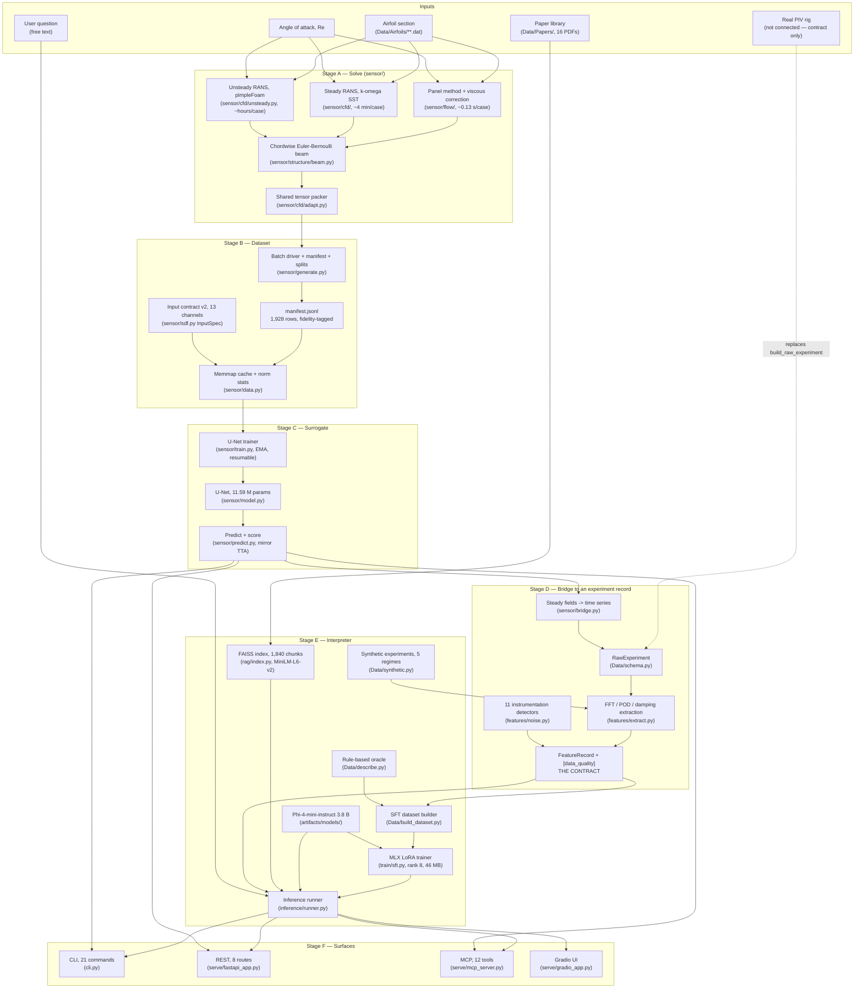
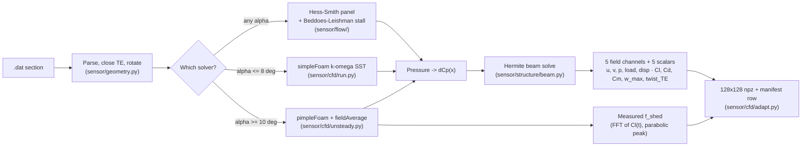
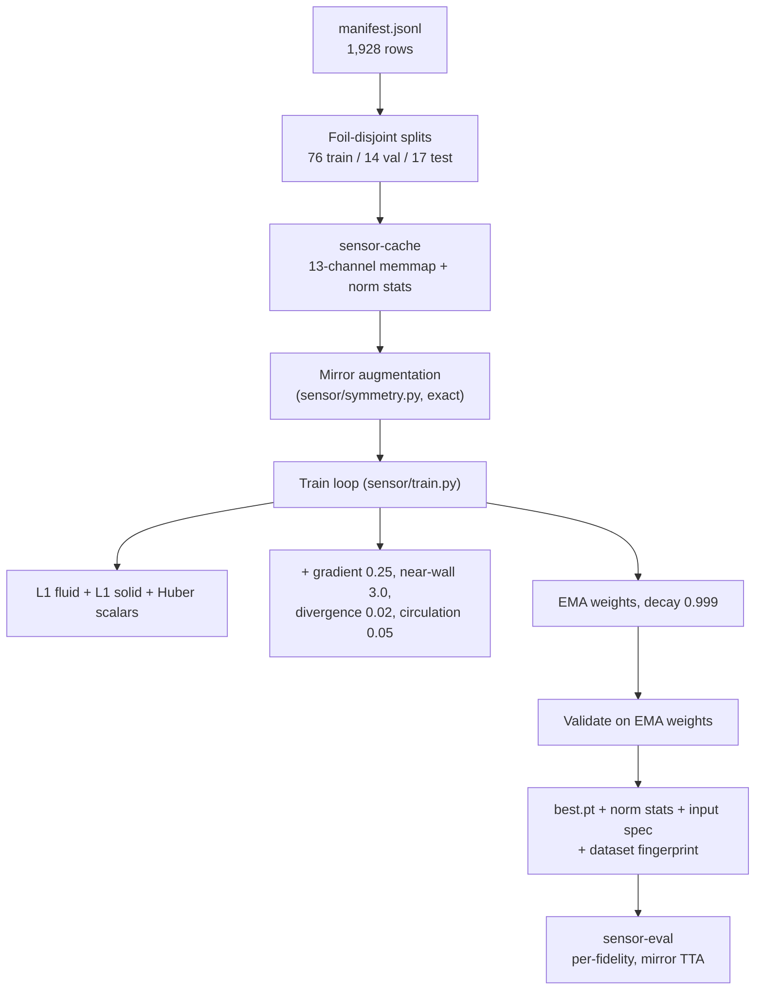
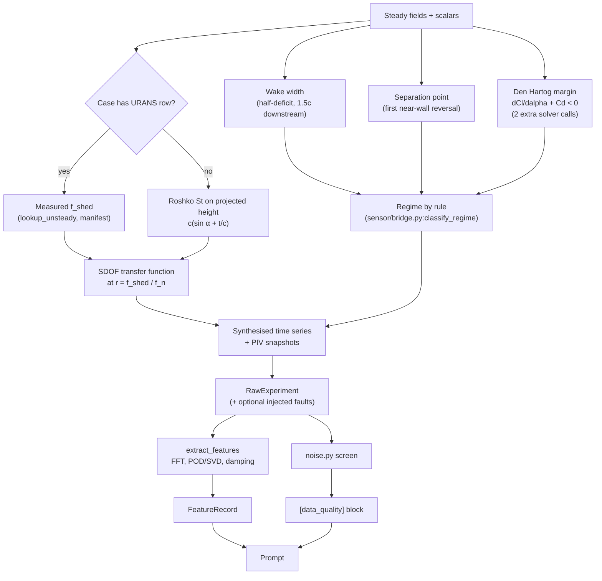
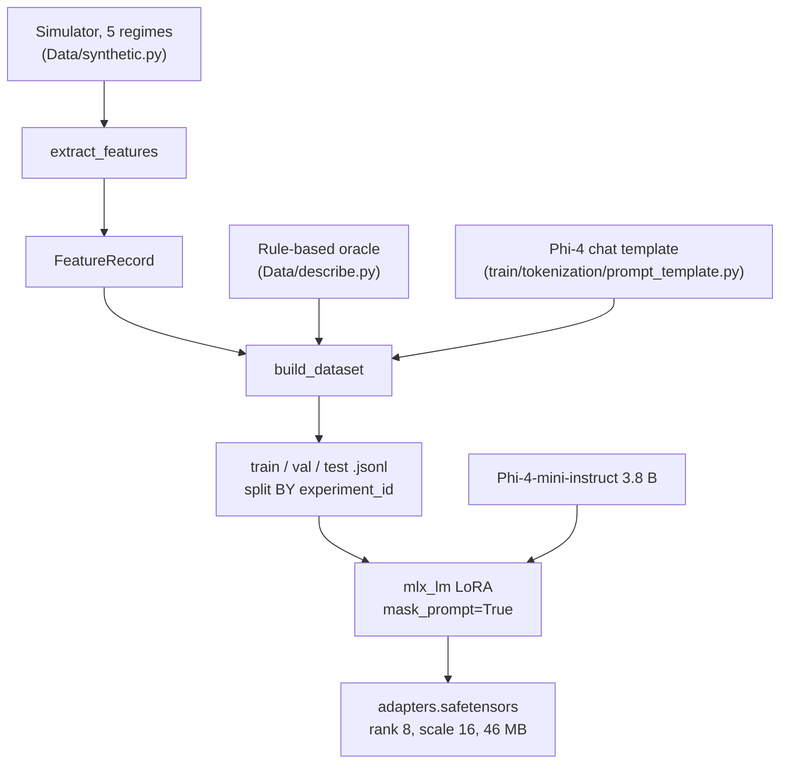
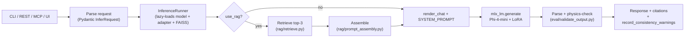
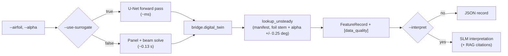
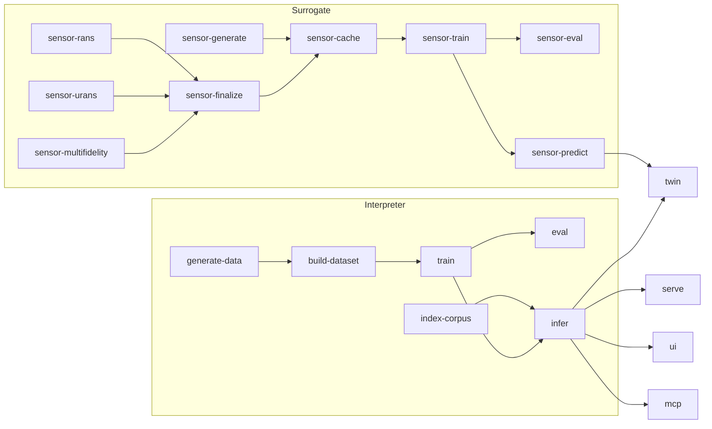

# FSI-SLM Project Workflow

How the repository fits together, end to end. Every box names the file that does
the work, so a box is greppable. Mermaid renders inline in GitHub, GitLab and
VSCode preview; `docs/workflow.txt` is the same content as ASCII for terminal
viewing.

The system has **two halves that meet at one contract**:

| Half | Question it answers | Entry point |
|---|---|---|
| **Surrogate** (`sensor/`) | *What does the flow do?* — geometry + incidence → fields, forces, deflection | `cli.py sensor-predict` |
| **Interpreter** (`Data/`, `features/`, `train/`, `rag/`, `inference/`) | *What does that mean?* — experiment record → regime, lock-in, caveats | `cli.py infer` |

The contract between them is `FeatureRecord` (`Data/schema.py`). The surrogate
produces one; the interpreter consumes one. Because the contract is the only
coupling, a real PIV rig can replace the surrogate without touching anything
downstream — that substitution point is `sensor/bridge.py:build_raw_experiment`.

`cli.py twin` runs both halves back to back, which is the full digital twin:
geometry in, interpreted experiment out, no human step.

---

## 1. The whole system

Two things in that diagram are worth stating outright rather than reading off
the arrows:

- **The surrogate is trained on solver output, not on the rig.** The dashed
  arrow from `RIG` is the only unimplemented edge in the picture. Every record
  the system produces today carries
  `provenance.signals = "synthesised by a 1-DOF instrument model, not measured"`.
- **The prior enters at cache time, not at solve time.** `pot_u/pot_v/pot_p` in
  the 13-channel input are a panel solve on the same raster, so the network
  learns the *correction* to potential flow. It costs ~40 ms per case and is
  available at every fidelity, which is what keeps panel and RANS rows
  interchangeable.

---

## 2. Surrogate pipeline (geometry → fields)

Solver choice is a measurement, not a preference. Every steady case at α ≥ 10°
in the RANS sweep hit the iteration cap with initial residuals of order 10⁻² and
lift oscillating by up to ±0.43 — massively separated flow has no steady
solution to converge *to*. `finalize_manifest` ranks `urans > rans > panel` for
the same (foil, angle), so re-solving upgrades a case in place.

## 3. Surrogate training

Splits hold out **whole sections**, never individual angles: splitting by case
would put the same shape in train and test at neighbouring incidences and
inflate the score without measuring generalisation. NACA 0009 is pinned to test,
so every number reported for it is a generalisation result.

The checkpoint carries its own normalisation statistics, its input spec, and a
fingerprint of the dataset. A changed dataset forces a recompute rather than
silently rescaling the loss, and a mismatched cache is refused with a message
rather than a broadcast error.

## 4. The twin bridge (fields → experiment record)

`provenance.shedding_frequency` on every record says which of the two frequency
paths was used. That distinction matters: lock-in is decided by comparing
`f_shed` to `f_n` at the few-percent level, so a measured frequency makes the
lock-in call mean something, and a correlated one makes it restate an
assumption.

---

## 5. Interpreter: training the SLM

`mask_prompt=True` means the loss covers assistant tokens only — the model is
never scored on reproducing the record it was handed. The ground-truth regime is
excluded from `to_prompt_block()`, so the model must infer it rather than copy
it.

## 6. Interpreter: serving one record

Two paths exist at serve time and they use **different models**:

| Path | Model | Why |
|---|---|---|
| `runner.generate` — structured interpretation | base **+ LoRA adapter** | the adapter is trained on exactly the fixed 6-part format |
| `runner.answer` — free-text Q&A | **base** instruct model | the adapter only knows the fixed format; open-ended questions go to the base model with the record pinned into context |

Neither path lets retrieved passages override the record. The system prompt
states the `FeatureRecord` is the only source of truth for measured numbers, and
`[data_quality]` flags carry an explicit instruction not to attribute an
instrumentation artefact to a flow mechanism.

## 7. Full twin (`cli.py twin`)

---

## 8. Data flow summary

| Stage | Inputs | Outputs | Tool |
|---|---|---|---|
| Solve (panel) | section + α + Re | 5 fields, 5 scalars | `sensor/flow/`, `sensor/structure/` |
| Solve (steady RANS) | section + α ≤ 8° | same contract + convergence record | `sensor/cfd/` |
| Solve (URANS) | section + α ≥ 10° | same + **measured** `f_shed` | `sensor/cfd/unsteady.py` |
| Generate | 107 sections × 18 angles | 1,926 `.npz` + manifest + splits | `sensor/generate.py` |
| Cache | manifest + `InputSpec` | 13-channel memmaps + norm stats | `sensor/data.py` |
| Train surrogate | cache | `best.pt` (11.59 M params) | `sensor/train.py` |
| Score surrogate | `best.pt` + held-out split | per-fidelity JSON metrics | `sensor/predict.py` |
| Bridge | steady fields | `RawExperiment` | `sensor/bridge.py` |
| Extract | `RawExperiment` | `FeatureRecord` | `features/extract.py` |
| Screen | `RawExperiment` signals | `[data_quality]` flags | `features/noise.py` |
| Synthesize | regime distribution | `RawExperiment` list | `Data/synthetic.py` |
| Build SFT | `FeatureRecord` + oracle | train/val/test JSONL | `Data/build_dataset.py` |
| Index | 16 PDFs | 1,840 chunks in FAISS | `rag/index.py` |
| Train SLM | JSONL + Phi-4-mini | LoRA adapter | `train/sft.py` |
| Interpret | `FeatureRecord` (+ passages) | structured text | `inference/runner.py:generate` |
| Answer | record + question (+ passages) | free text + citations | `inference/runner.py:answer` |
| Score SLM | prediction vs ground truth | JSON + Markdown report | `eval/evaluate.py`, `eval/report.py` |

## 9. Command map

| Surface | Entry points |
|---|---|
| CLI | 21 commands; `python cli.py -- --help` lists them |
| REST | `GET /health`, `GET /schema`, `POST /infer`, `POST /infer/stream`, `GET /sensor/status`, `POST /sensor/predict`, `POST /sensor/polar`, `POST /twin` |
| MCP | 12 tools — `interpret_experiment`, `ask_question`, `search_literature`, `validate_interpretation`, `check_experiment_consistency`, `sweep_regime_map`, `generate_synthetic_experiment`, `predict_flow`, `predict_polar`, `digital_twin_record`, `check_data_quality`, `surrogate_status` |
| UI | Gradio: upload/enter a record, interpret, ask, what-if sweep |

All three of CLI, REST and MCP call `sensor/api.py` for surrogate work and
`inference/runner.py` for language work, so the surfaces cannot drift apart.
