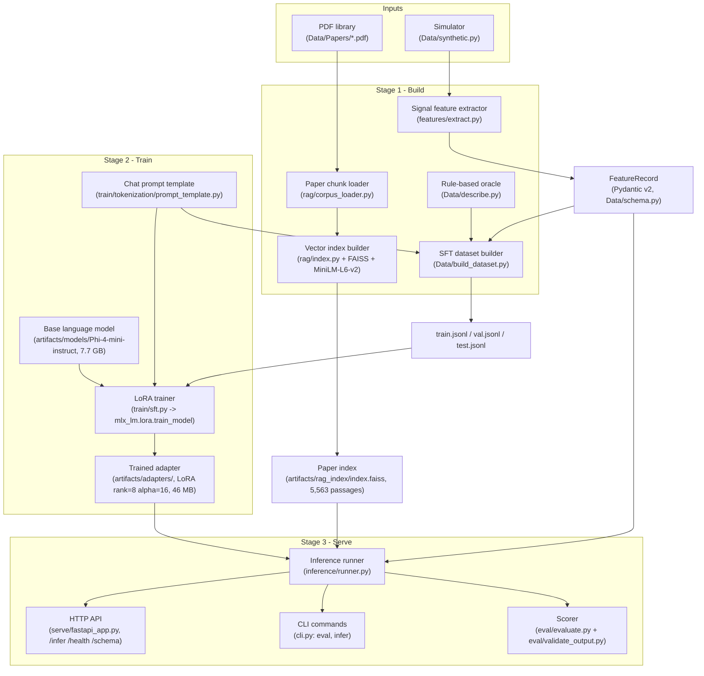
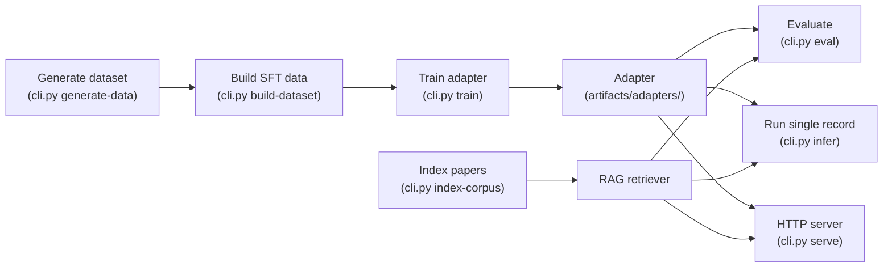

# FSI-SLM Project Workflow

End-to-end pipeline diagram for training and serving the Fluid-Structure
Interaction Small Language Model. Renders inline in any markdown viewer
that supports Mermaid (GitHub, GitLab, VSCode preview, etc.).

## High-level pipeline



## CLI command flow



## Inference pipeline (single FeatureRecord -> text)

```mermaid
flowchart LR
    A[Client / CLI / HTTP] -->|POST| B[HTTP handler<br/>(serve/fastapi_app.py)]
    B --> C[Parse request<br/>(Pydantic InferRequest)]
    C --> D[Inference runner<br/>(inference/runner.py)]
    D -->|no RAG| E[Build prompt<br/>(render_chat + SYSTEM_PROMPT)]
    D -->|use_rag| F[Retrieve top-3<br/>(FAISS via rag/retrieve.py)]
    F --> G[Assemble RAG prompt<br/>(rag/prompt_assembly.py)]
    G --> E
    E --> H[Generate text<br/>(mlx_lm.generate)]
    H --> I[Phi-4-mini + LoRA adapter<br/>(artifacts/adapters/)]
    I --> J[Raw text]
    J --> K[Parse + validate<br/>(eval/validate_output.py)]
    K --> L[JSON response<br/>(InferResponse)]
    L -->|JSON| A
```

## Training loop (inside train/sft.py)

```mermaid
flowchart TB
    S[Configuration<br/>(TrainingConfig dataclass)] --> L["Load base model<br/>(mlx_lm.utils.load)"]
    L --> F["Inject LoRA<br/>(linear_to_lora_layers -> all linear)"]
    F --> D["Tokenize SFT data<br/>(ChatDataset + mask_prompt=True)"]
    D --> T["Train loop<br/>(mlx_lm.tuner.train)"]
    T -->|every save_every| C["Checkpoint<br/>(0000xxx_adapters.safetensors)"]
    T --> F1["Final adapter<br/>(artifacts/adapters/adapters.safetensors)"]
    F1 --> WD["Adapter + config<br/>(adapter_config.json)"]
```

## Data flow summary

| Stage | Inputs | Outputs | Tool |
|---|---|---|---|
| Synthesize | random + regime distribution | RawExperiment list | `Data/synthetic.py` |
| Feature extraction | RawExperiment | FeatureRecord | `features/extract.py` |
| Build dataset | FeatureRecord + (optional) FAISS hits | train/val/test JSONL | `Data/build_dataset.py` |
| Index corpus | PDFs in `Data/Papers/` | `index.faiss` + `metadata.json` | `rag/index.py` |
| Train | JSONL + Phi-4-mini base | LoRA adapter | `train/sft.py` |
| Inference | FeatureRecord (+ optional FAISS hits) + adapter | structured text | `inference/runner.py` |
| Score predictions | prediction text vs ground truth | JSON metrics | `eval/evaluate.py` |
| Serve | same as inference | JSON via HTTP | `serve/fastapi_app.py` |
