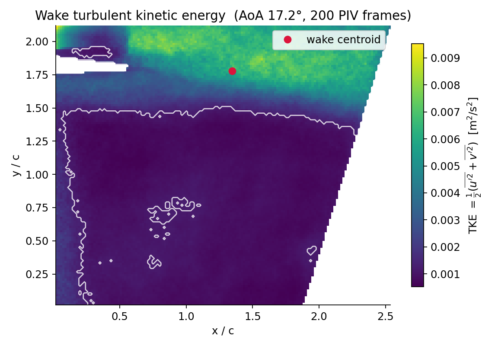
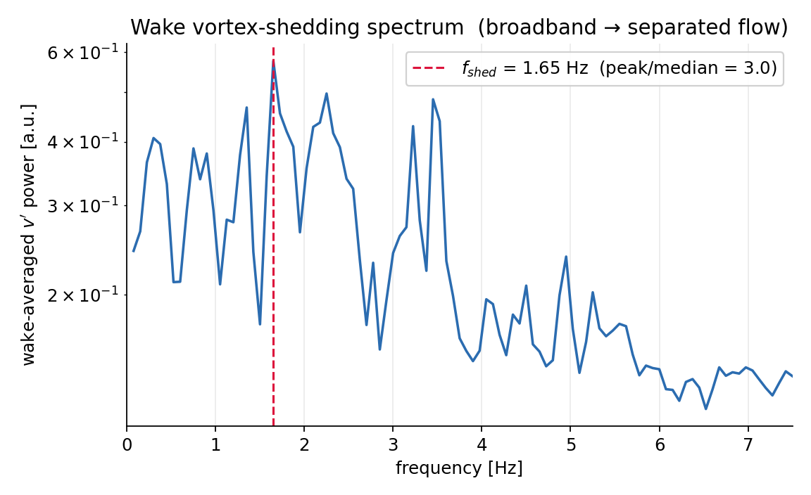
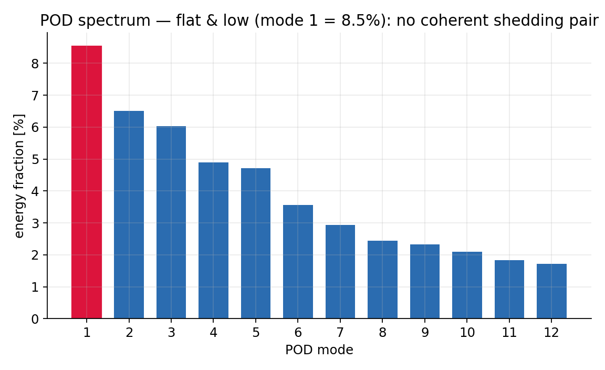
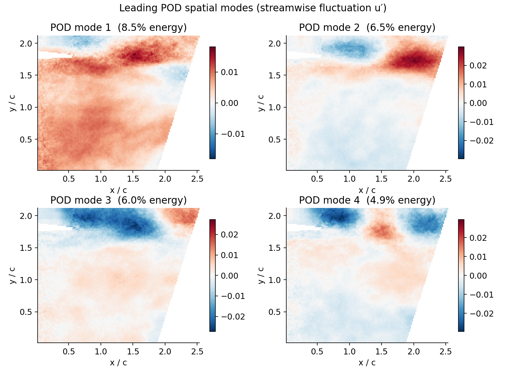

# Real PIV → FSI-SLM interpretation — NACA0009, AoA 17.2°

**Run `real_piv_AOA17.2_Run_120030`** — the first real experimental dataset carried
end-to-end through the FSI-SLM pipeline. This closes the loop the whole project was
built for: `Data/schema.py` and `features/extract.py` were written against a *future
real-data source*; this is that source.

Regenerate everything below with:

```bash
python cli.py ingest-piv                     # or: python scripts/ingest_real_piv.py
```

---

## 1. What the data is

200 DaVis `DSExport` CSV frames in `Exports/` (one per PIV snapshot).

| property | value |
|---|---|
| grid | 152 × 127 vectors, Δx = Δy = 1.67 mm |
| field of view | 0.254 m × 0.212 m ≈ 2.5c × 2.1c |
| frames | 200 |
| sampling rate | 15.0 Hz (Δt = 66.66 ms) |
| record length | 13.27 s |
| angle of attack | **17.2°** (from the frame `Originator` tag) |
| columns | X, Y, Z, Status, U, V, Length |

**Critical property:** the exports are **mean-subtracted fluctuation fields** — the
`Originator` tag reads `… Vector Arithmetic` and the time-mean velocity is 0.000 at
every domain border. These are `u′, v′`, not instantaneous velocities. Every
modelling choice below follows from that fact, made explicit rather than hidden.

## 2. Method (`features/piv_ingest.py`)

DaVis frames → `RawExperiment` → **unchanged `features.extract.extract_features`** →
`FeatureRecord`. The real-data path is byte-for-byte the synthetic path from feature
extraction onward — exactly the contract the schema docstring promised.

- **Shedding frequency** — dominant peak of the wake-averaged, drift-removed `v′`
  spectrum (transverse velocity is the standard shedding indicator).
- **POD** — SVD of the fluctuating-velocity snapshot stack (the frames *are*
  fluctuations, so they feed POD directly).
- **Wake width / length** — TKE-weighted PCA of the energetic wake region
  (orientation-free: minor axis = width, major axis = streamwise length).
- **TKE** — `½⟨u′²+v′²⟩` over the wake, dimensional and normalised by `U²`.
- **Strouhal, Reynolds** — need `U` and `c`, which a mean-subtracted field cannot
  provide. They are **rig inputs**: `U = 1.569 m/s` (constant-flow pump, the same
  constant `Data/synthetic.py` uses) and `c = 0.100 m` (NACA0009 printed foil). Both
  are documented and overridable (`--freestream`, `--chord`).
- **Separation point** — needs the mean field (removed here); supplied from stall
  physics with a provenance note, never fabricated as a measurement.
- **Structural displacement & Cl/Cd/Cm** — acquired by *separate* subsystems (load
  cell, video strain tracking), absent from a PIV-only export. Written as zeros so
  the single code path runs, and left for the validators to flag.

## 3. Results (measured from PIV)

| quantity | value | note |
|---|---|---|
| shedding frequency `f_shed` | **1.65 Hz** | wake `v′` spectral peak (peak/median = 3.0 → weak tone) |
| Strouhal `St = f·c/U` | **0.105** | chord-based; airfoil band |
| wake width | **0.65 c** | PCA minor axis; wake length 1.41 c |
| TKE (norm.) | 0.0017 | dimensional 0.0041 m²/s²; turbulence intensity 3.3% |
| POD mode-1 energy | **8.5%** | modes 2–4: 6.5 / 6.0 / 4.9% — **flat, no dominant pair** |
| Reynolds `Re = U·c/ν` | 1.57 × 10⁵ | ν = 1.0×10⁻⁶ m²/s (water); matches the project's own reference operating point |
| lock-in | **unlocked** | no structural resonance channel acquired |






**Physical reading:** a symmetric NACA0009 at 17.2° is ~8° past its static stall
(~9–10°) → **deep stall / massively separated flow**. Every measurement agrees: a
turbulent wake band ≈0.65 c wide concentrated in a detached shear layer, a
**broadband** shedding spectrum with only a weak 1.65 Hz tone, and a **flat POD
spectrum** (no energetic mode-1/mode-2 pair — the signature of a *clean* von Kármán
street — is absent). This is **separated flow**, not VIV lock-in.

## 4. The trust layer, on real data

The record was run through all three deterministic validators *and* the LoRA SLM.
This is the "trust layer under the ML layer" thesis, tested for real:

- **Range check** — one warning: `reduced_velocity = 0` (correct: reduced velocity
  needs a structural natural frequency, which this PIV-only run does not have).
- **Physics consistency** — clean (reported St equals `f·c/U`; no contradictions).
- **Instrumentation screen** — verdict *unusable*, and rightly so: 4 of 5 channels
  (`structural_displacement`, `cl`, `cd`, `cm`) flatline because they were never
  acquired in a PIV-only export. The one real signal, the wake `v′` probe, passes
  (a trivial 1%-clip flag aside).
- **Rule-based baseline (`Data/describe.py`)** → **separated**, confidence 0.88.
  Independent of the neural model, and correct.
- **LoRA SLM (`interpret_experiment`)** → claimed **"VIV lock-in, confidence 1.00,
  saturated limit cycle."** This is *wrong* — an overreach triggered by the
  zero-valued structural channel. **Both `check_experiment_consistency` and
  `validate_interpretation` rejected it** (`valid: false — "Natural frequency
  0.0 Hz must be positive"`).

**Headline finding:** on real, incomplete data the neural interpreter cannot be
trusted blind — it invented a structural limit cycle from an absent channel — and
the deterministic validators caught it before it could be believed. The correct
flow-regime call (**separated**) comes from the PIV measurements and the rule-based
classifier, both consistent with the physics. That is the multi-fidelity trust
architecture working as designed.

## 5. Verdict

> **Regime: separated (deep stall).** NACA0009 at Re ≈ 1.6×10⁵, AoA 17.2°: a
> massively separated, broadband turbulent wake (width ≈ 0.65 c), weak intermittent
> shedding near St ≈ 0.10–0.15, no vortex-induced lock-in. Structural/force channels
> were not part of this PIV export, so aeroelastic coupling could not be assessed —
> and the pipeline says so explicitly instead of guessing.

## 6. Limitations / next data

- `U` and `c` are rig inputs (unavoidable for a mean-subtracted export); St and Re
  scale with them — see `--freestream`/`--chord` for sensitivity.
- 15 Hz sampling gives a 7.5 Hz Nyquist; fine for the ~1.65 Hz tone, marginal for
  fine-scale turbulence, so normalised TKE reads low.
- To assess lock-in, ingest the synchronized **load-cell** (Cl/Cd/Cm) and
  **video-strain** (displacement, `f_n`) channels into the same `RawExperiment`; the
  downstream path already supports them and needs no changes.

---

*Artifacts: `feature_record.json` (model input), `analysis.json` (full provenance +
diagnostics), `wake_probe_signal.json`, `figures/`. Pipeline: `features/piv_ingest.py`,
driver `scripts/ingest_real_piv.py`, CLI `python cli.py ingest-piv`.*
